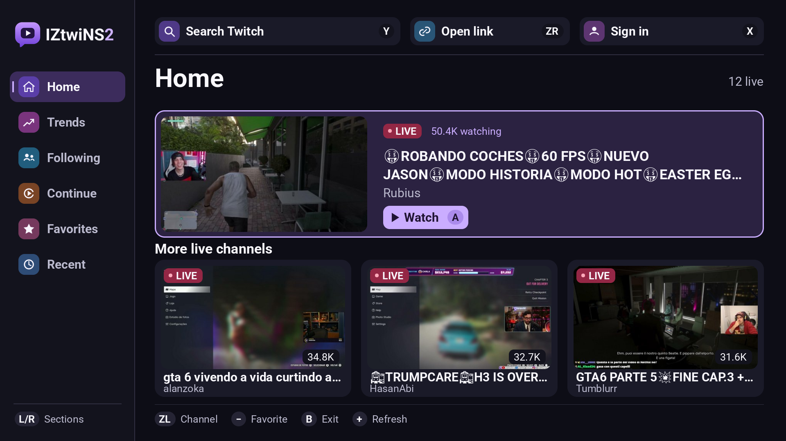
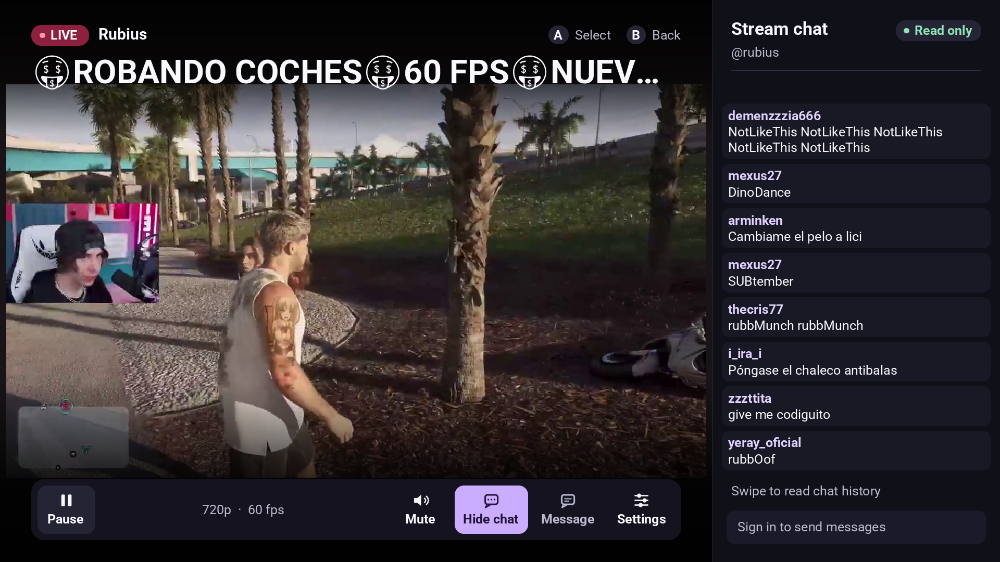
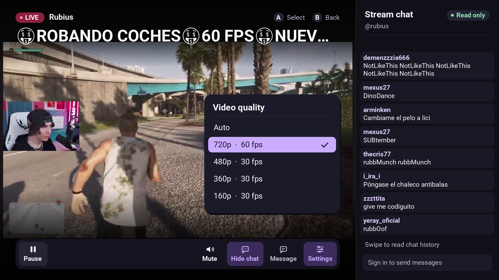

# IZtwiNS2

  

IZtwiNS2 is a standalone Twitch client for Nintendo Switch 2. Browse live channels and categories, watch streams, videos and clips, and read or send Twitch chat from the console.

## Compatibility

| Platform | Build |
| --- | --- |
| [IZ2S](https://github.com/byizmysh/IZ2S-Platform) | `.iza` |
| [KaiHEN](https://github.com/ouncebrew/kaihen) | `.nro` |

## Install

### Through the IZ2S App library

1. Download [`IZtwiNS2-0.11.0.iza`](https://github.com/byizmysh/IZtwiNS2/releases/download/v0.11.0/IZtwiNS2-0.11.0.iza).
2. Import the file in **App library** and install it to the Switch 2 SD card. IZ2S places the app in `sd:/iz2s/modules/iztwins2/`.
3. Open **IZtwiNS2** from the launcher. From a main section, press **B** or tap **Exit** to return to IZ2S.

### Through KaiHEN Homebrew Menu

1. Download [`IZtwiNS2-0.11.0.nro`](https://github.com/byizmysh/IZtwiNS2/releases/download/v0.11.0/IZtwiNS2-0.11.0.nro).
2. Copy it to `sd:/switch/`.
3. Open **IZtwiNS2** from the Homebrew Menu. IZ2S can also open this build from its `.nro` entry.

### Package contents

The **16.1 MiB IZA download** contains the complete IZtwiNS2 module for an existing IZ2S installation. App library unpacks `launcher.iza` with the frontend and shaders, `asset-<sha256>.izdata` with the ARM64 player and multilingual fonts, and `sd-bundle.json` with the asset description and checksums. Keep the installed files together. They occupy about 26.8 MiB on the SD card before user data.

The **62.2 MiB NRO download** is an uncompressed Switch 2 executable with an icon, metadata, and a RomFS resource section. About 35.7 MiB is an embedded IZ2S Launcher NRO for use as a return entry on older standalone IZ2S setups.

## Features

- Browse **Home**, **Trends**, **Following**, favorites, and watch history. Search Twitch or open a channel, video, or clip link.
- Watch compatible H.264 streams up to **720p**, select quality, enable captions, and seek in recorded broadcasts.
- Read live chat as a guest. Sign in using Twitch’s device flow to view followed channels and send messages.
- Use the controller or touchscreen. Drag the timeline to seek and swipe through chat history.
- The native IZ2S build renders the interface in **1920×1080** and includes fonts for multilingual titles and chat.

## Screenshots

## Source and licenses

IZtwiNS2 began as a Switch 2 port of [twiNX](https://github.com/DomazinUS/twiNX/tree/2d4338b96f1e18978391c63e54cb1df8d22501dc), a Twitch client for Nintendo Switch. The port adapts twiNX's Twitch playback requests and device sign-in flow and uses socket and TLS integration adapted from [IZ2S Cheese](https://github.com/byizmysh/iz2s-cheese). The Switch 2 interface, touch controls, chat panel, and IZ2S frontend are implemented in this repository. IZtwiNS2 application code is [GPL-3.0-only](LICENSE).

| Component | Use in IZtwiNS2 | License |
| --- | --- | --- |
| twiNX | Playback access requests and Twitch device authorization | [GPL v3](https://github.com/DomazinUS/twiNX/blob/2d4338b96f1e18978391c63e54cb1df8d22501dc/LICENSE) |
| IZ2S Cheese | Switch 2 socket and TLS service lifecycle | [MIT](source/licenses/IZ2S-Cheese-MIT.txt) |
| [FFmpeg](source/ffmpeg/) | MPEG-TS and fragmented MP4 demuxing, H.264 and AAC decoding, captions, scaling, and audio resampling | [LGPL-2.1-or-later](source/ffmpeg/LICENSE.md) for the selected build components |
| [FreeType](source/textdeps/freetype/) | Font rasterization | [FreeType License or GPL-2.0-or-later](source/textdeps/freetype/LICENSE.TXT) |
| [HarfBuzz](source/textdeps/harfbuzz/) | Unicode text shaping | [Old MIT](source/textdeps/harfbuzz/COPYING) |
| [FriBidi](source/textdeps/fribidi/) | Left-to-right and right-to-left text ordering | [LGPL-2.1-or-later](source/textdeps/fribidi/COPYING) |
| Roboto, Noto, Noto CJK, and Noto Emoji | Embedded interface, subtitle, and chat fonts | [SIL Open Font License 1.1](source/licenses/) |
| nlohmann/json, Nayuki QR Code generator, and stb_image | Twitch JSON parsing, sign-in QR codes, and thumbnail decoding | [MIT, with a public-domain alternative for stb_image](THIRD_PARTY.md) |

The native `.iza` uses the IZ2S SDK and its libsb4 ABI 7 runtime. The `.nro` is built with [libounce](https://github.com/ouncebrew/libounce) and includes an IZ2S Launcher return entry. The [third-party notices](THIRD_PARTY.md) link to the individual runtime and dependency licenses.

See the [source tree](source/), [build instructions](BUILDING.md), [changelog](CHANGELOG.md), and [media sources](docs/media-sources.md).
