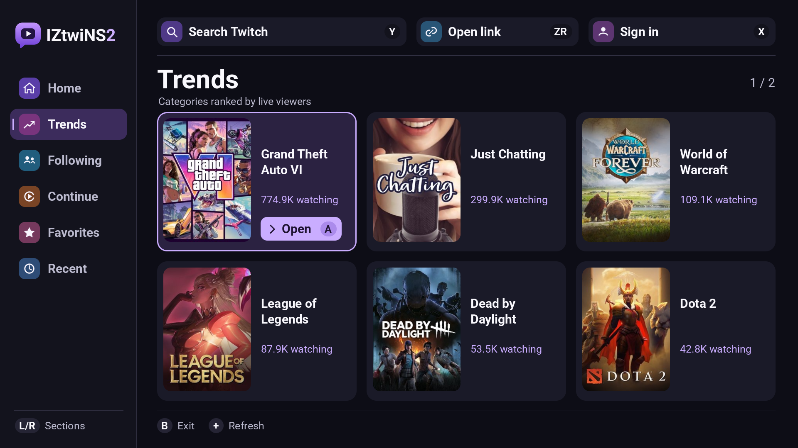

# IZtwiNS2

IZtwiNS2 is a standalone Twitch client for Nintendo Switch 2. Browse live channels and categories, watch streams, videos and clips, and read or send Twitch chat from the console.

## Compatibility

| Platform | Builds |
| --- | --- |
| Nintendo Switch 2 with [IZ2S](https://github.com/byizmysh/IZ2S-Platform) | Native `.iza` and standalone Switch 2 `.nro` |

## Install

### Through the IZ2S App library

1. Download [IZtwiNS2 0.11.0 (.iza)](https://github.com/byizmysh/IZtwiNS2/releases/download/v0.11.0/IZtwiNS2-0.11.0-native.iza).
2. Import the file in **App library** and install it to the Switch 2 SD card. IZ2S places the app in `sd:/iz2s/modules/iztwins2/`.
3. Open **IZtwiNS2** from the launcher. From a main section, press **B** or tap **Exit** to return to IZ2S.

### Standalone NRO

1. Download [IZtwiNS2 0.11.0 (.nro)](https://github.com/byizmysh/IZtwiNS2/releases/download/v0.11.0/IZtwiNS2-0.11.0.nro).
2. Copy it to `sd:/switch/IZtwiNS2-NRO.nro` and refresh the application list in your Switch 2 NRO launcher. In IZ2S the NRO and IZA can coexist as separate entries.
3. Open the **IZtwiNS2** entry marked `.nro`.

## Features

- Browse **Home**, **Trends**, **Following**, favorites, and watch history. Search Twitch or open a channel, video, or clip link.
- Watch compatible H.264 streams up to **720p**, select quality, enable captions, and seek in recorded broadcasts.
- Read live chat as a guest. Sign in using Twitch’s device flow to view followed channels and send messages.
- Use the controller or touchscreen. Drag the timeline to seek and swipe through chat history.
- The native IZ2S build renders the interface in **1920×1080** and includes fonts for multilingual titles and chat.

## Screenshots

## Source and licenses

The [source tree](source/) contains the client, build recipes, bundled dependencies, and license texts. See [Building](BUILDING.md), [Changelog](CHANGELOG.md), [Third-party notices](THIRD_PARTY.md), and [Media sources](docs/media-sources.md).
